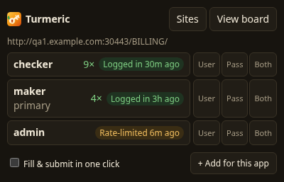
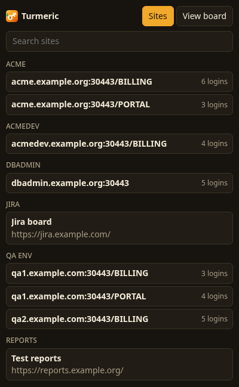
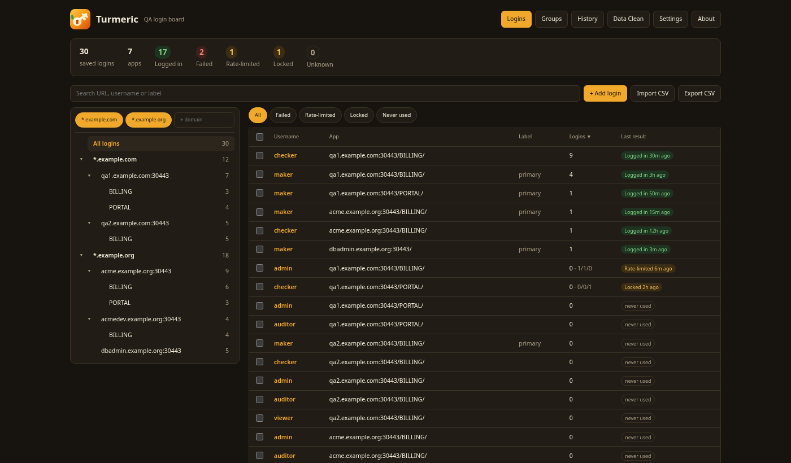
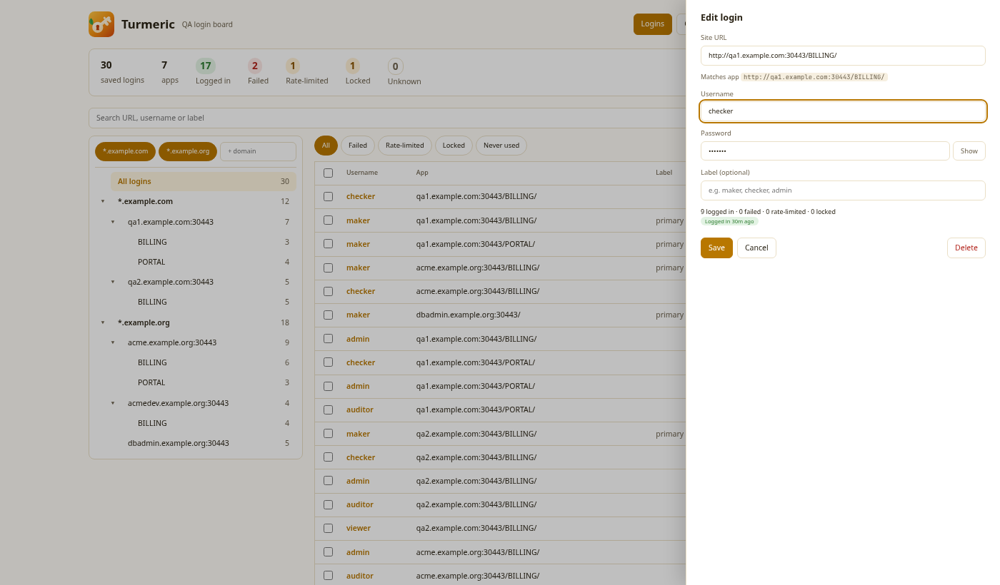
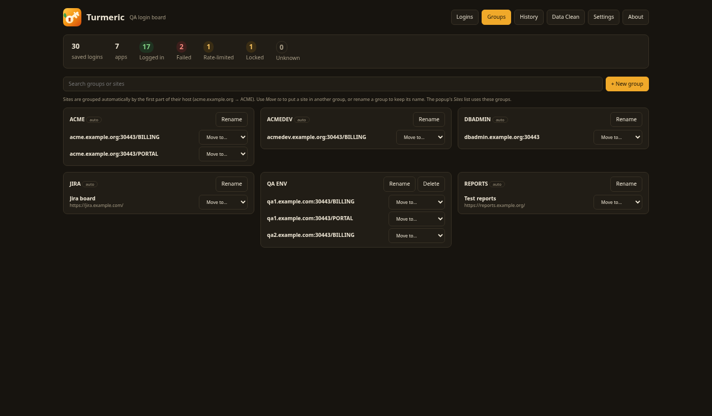

<p align="center">
  
</p>

<h1 align="center">Turmeric</h1>

<p align="center">
  A Chrome / Brave extension for QA teams: the right test login for the <em>exact</em> app you're on,<br>
  with a history of which logins work, failed, got rate-limited or locked.
</p>

<p align="center">
  
  &nbsp;
  
</p>

## Why

Browser password managers group saved logins by host. QA environments usually share hosts and differ only by
port, subdomain or app path:

```
qa1.example.com:30443/BILLING/     qa1.example.com:30443/PORTAL/     acme.example.org/BILLING/
```

So every login page offers 20+ unrelated accounts, and nobody knows which one still works, which one is locked,
or which one a teammate's test just rate-limited. Turmeric keeps test logins **per app** and remembers how each login went.

## Features

- **Exact-app matching**: a site is host + port + first path segment, so `/BILLING/` and `/PORTAL/` on the same host stay separate.
- **Popup**: logins for the current app, most successfully used first, with the last result ("Rate-limited 6m ago").
  Fill, or fill & submit in one click. Copy the username, the password, or both as `Username: … / Password: …`.
- **Red dot** on the toolbar icon when Turmeric has logins for the current site.
- **Login results** are read from the page: an error appears (failed / rate-limited / locked, with the app's own message)
  or the login form goes away (logged in). Works with AngularJS, Angular, React and dialog-style logins.
- **Sites list**: every QA app you have logins for, plus bookmarks, grouped by application (`acme.example.org/*` → ACME);
  shown straight away on a new tab. Groups can be renamed and rearranged.
- **Board** (full tab): tree of domain → host:port → app, domain filter chips, result filters, sortable table,
  edit side panel, bulk move/delete, CSV import/export, history.
- **Allowed domains**: only logins on your team's QA domains are ever imported, saved, exported or listed.
  A full browser password export can be imported safely: personal sites are dropped, not stored.
- **Data Clean**: duplicates, logins outside allowed domains, logins without an app path, unused logins,
  and the list of hosts to delete from the browser's own password manager.
- **Settings**: light / dark / system theme, text size, page width, row density, fill behaviour,
  and an optional switch that stops the browser offering to save passwords.

<p align="center">
  
</p>

<p align="center">
  
  
</p>

## Install (from source)

Requires Node 20+.

```sh
git clone https://github.com/kannan983/turmeric.git
cd turmeric
npm ci
npm run build
```

Then in Chrome or Brave:

1. Open `chrome://extensions` (or `brave://extensions`) and turn on **Developer mode**.
2. Click **Load unpacked** and pick the `dist` folder.
3. Pin Turmeric to the toolbar.

After pulling changes: `npm run build`, then press the reload button on Turmeric's card.

## First run

1. Click the Turmeric icon → **View board** → enter your team's QA domain (e.g. `example.com`, which covers every subdomain).
   Click **Grant site access** in **Settings** for the red dot.
2. Add logins with **+ Add login**, or **Import CSV**. To move logins over from the browser:
   `chrome://password-manager/settings` → **Export passwords**, import the file, then delete it.
3. Open a QA app's login page, click the icon, pick a login.

## Security and privacy

- Meant for **QA test accounts**. Passwords are stored unencrypted in the browser's local extension storage
  (`chrome.storage.local`, not synced to any account). Uninstalling the extension deletes them, so export a CSV first.
- No network requests, no analytics, no remote code.
- Turmeric only runs on a page when you click its icon (`activeTab`), only fills a page whose origin matches the login
  it was matched for, and never reads passwords from pages or network traffic.
- Exports only contain logins on allowed domains.
- The optional "stop offering to save passwords" switch changes a browser-wide setting (`privacy` permission);
  untick it to hand control back to the browser.

## Development

```sh
npm run dev         # rebuild dist/ on every change
npm test            # logic tests (node --test)
npm run test:e2e    # builds, then drives Chromium with the extension against a fake login server
npm run icons       # re-render PNG icons from public/logo.svg
npm run screenshots # re-render README screenshots with demo data
```

The end-to-end tests need Playwright's Chromium once: `npx playwright install chromium`.

```
public/            manifest, content script (fill + result detection), logo, icons
src/lib.js         pure logic: site keys, matching, ranking, CSV, domains, tree, groups, cleanup
src/background.js  red-dot badge, re-applies browser setting, prunes history
src/*.svelte       popup and board UI (Svelte 5)
test/              logic tests and the end-to-end test
scripts/           icon and screenshot generators
```

## Author

Built by **Kannan** for QA teams.

## License

[MIT](LICENSE)
